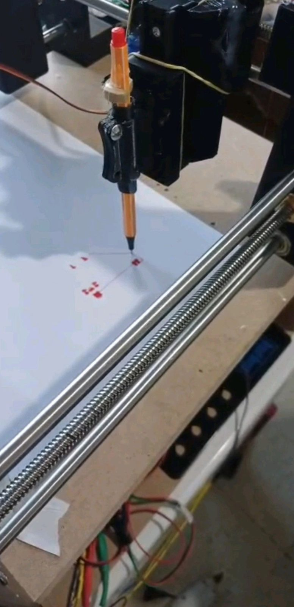
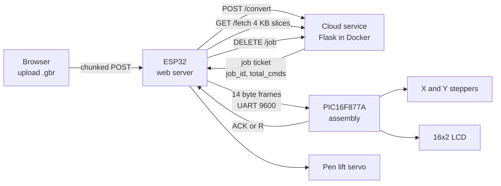
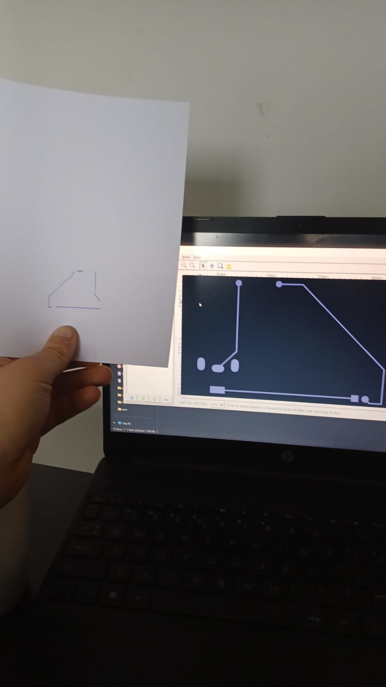
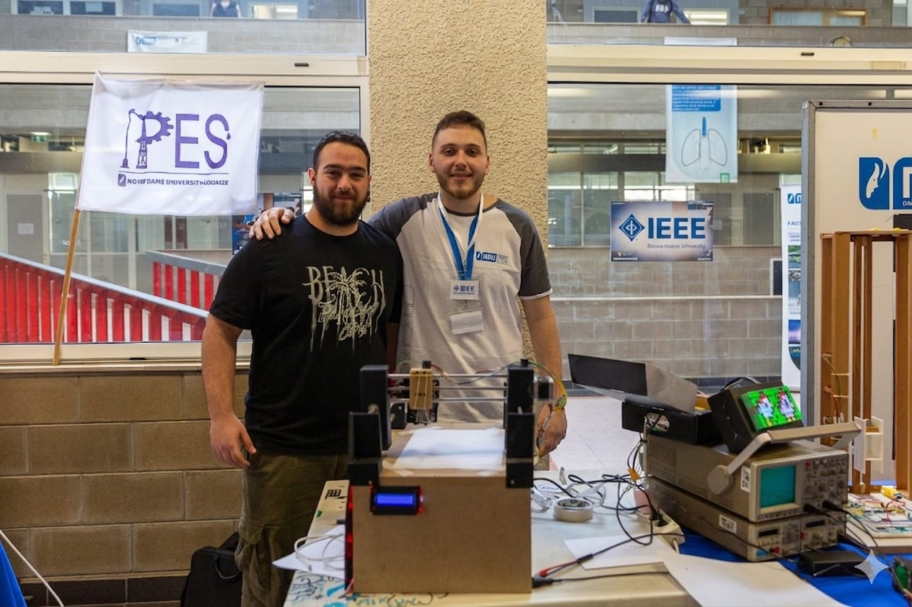
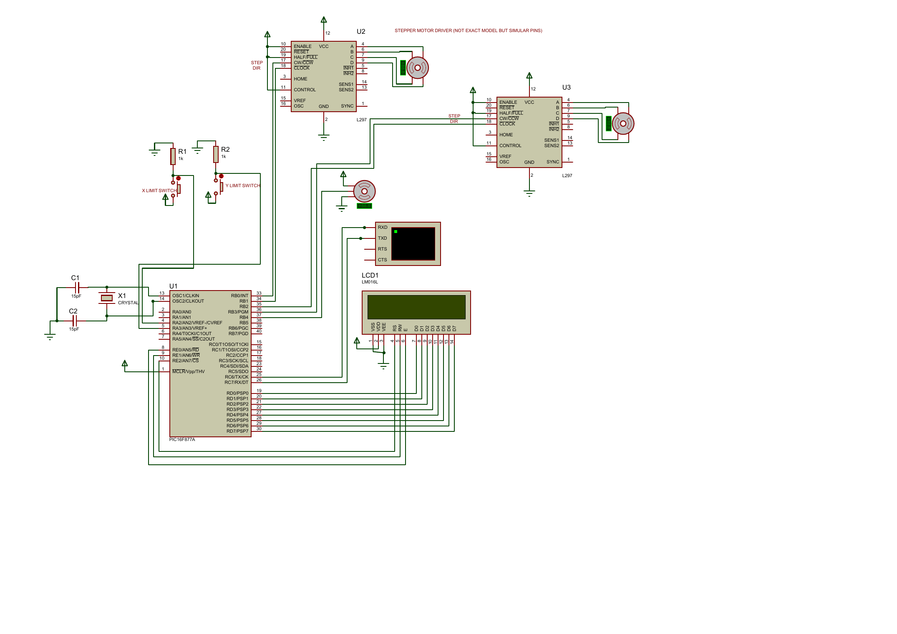
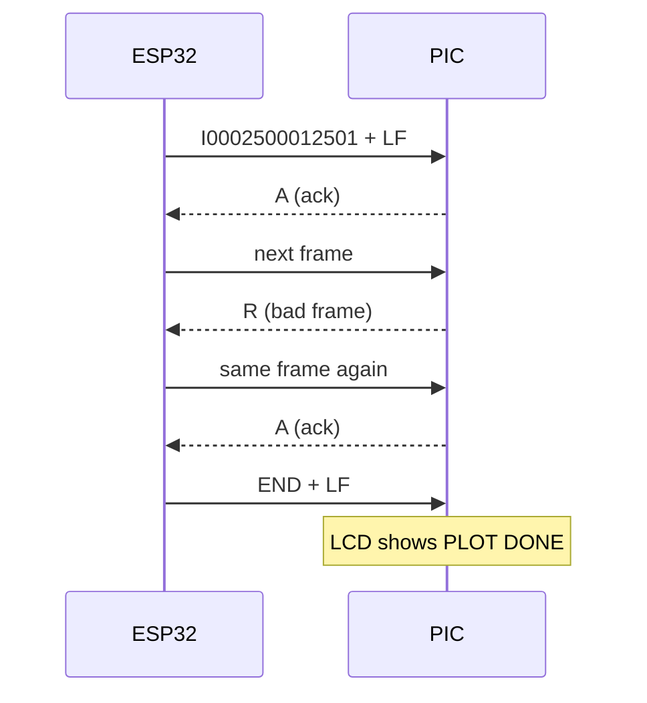
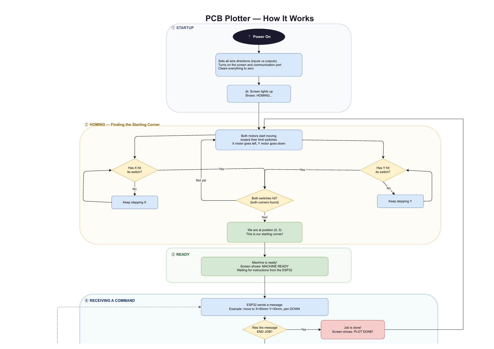
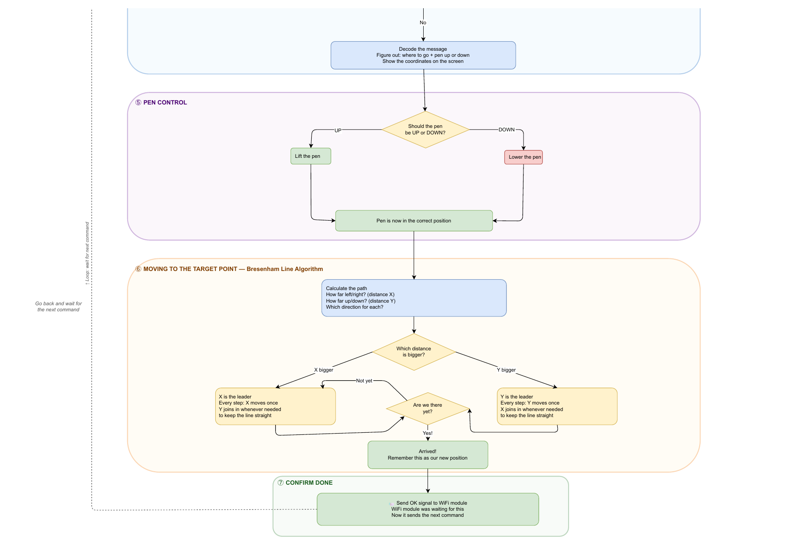
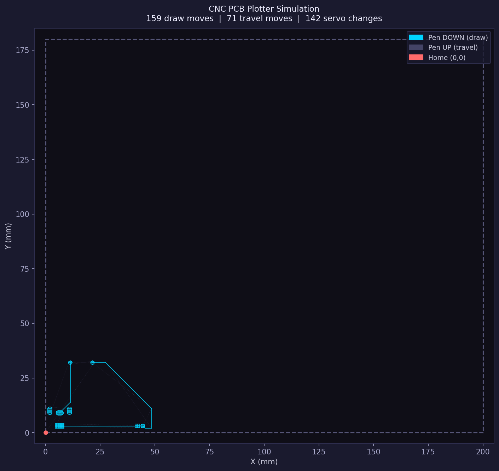

<div align="center">

# PCB ETCHER

**Drop a Gerber file in your browser. Watch a pen draw your circuit onto copper.**

A 2 axis plotter that draws PCB traces as etch resist. A PIC16F877A written in pure assembly drives the motors. An ESP32 hosts the web page and talks to a small cloud service that turns Gerber into motion.




<sub>The machine mid trace.</sub>

</div>

---

## Contents

1. [How it works](#how-it-works)
2. [The hardware](#the-hardware)
3. [Wiring](#wiring)
4. [The protocol](#the-protocol)
5. [Firmware flow](#firmware-flow)
6. [Getting started](#getting-started)
7. [Simulate before you plot](#simulate-before-you-plot)
8. [Repo layout](#repo-layout)
9. [Machine constants](#machine-constants)
10. [Credits](#credits)

---

## How it works

Three pieces. Each one does a single job.



1. **You upload** a Gerber file from the page the ESP32 serves on your network.
2. **The cloud service** parses the Gerber, fills pads, mirrors the board for toner transfer, and writes a list of moves to a temp file. It returns a small job ticket.
3. **The ESP32 pulls the job** in 4 KB slices. It opens TLS, grabs a slice, and closes TLS. It never holds a connection open while the motors run. This fixed an old hang that hit around 3000 commands.
4. **The PIC runs each move** with a Bresenham line routine and answers every frame with `A`. A bad frame gets an `R` and the ESP32 resends it.
5. **The job ends** with `END`. The ESP32 deletes the job from the server.

---

## The hardware

<table>
<tr>
<td width="50%"></td>
<td width="50%"></td>
</tr>
<tr>
<td align="center"><sub>Hand drawn layout next to the pipeline that plots it</sub></td>
<td align="center"><sub>Running live at NDU Open Doors</sub></td>
</tr>
</table>

| Part | What it does |
| :--- | :--- |
| PIC16F877A, HS crystal | Motion control, homing, LCD, UART |
| ESP32 | Wi‑Fi, web UI, cloud fetch, pen servo on GPIO 23 |
| 2 × NEMA 17 + T8 lead screws | X and Y travel |
| 2 × stepper drivers (L297 style, STEP/DIR) | Turn STEP pulses into coil current |
| Continuous rotation servo | Lifts and drops the pen |
| 2 × limit switches | Homing on X and Y |
| 16x2 LCD (HD44780) | Status: HOMING, MACHINE READY, PLOT DONE |

All printable parts live in [`3d prints/`](3d%20prints). STL files are ready to slice.

---

## Wiring



The full schematic is in [`documentations/wiring.pdf`](documentations/wiring.pdf). The Proteus project sits in [`simulations/`](simulations).

| PIC pin | Signal |
| :--- | :--- |
| RB0 | X STEP |
| RB1 | X DIR |
| RB2 | Y STEP |
| RB3 | Y DIR |
| RA2 | X limit switch |
| RA3 | Y limit switch |
| RC6 / RC7 | UART TX / RX to ESP32 |
| PORTD | LCD data |
| RE0 / RE1 / RE2 | LCD E / RW / RS |

| ESP32 pin | Signal |
| :--- | :--- |
| GPIO 16 | RX from PIC |
| GPIO 17 | TX to PIC |
| GPIO 23 | Pen servo PWM |

> The PIC runs at 5 V and the ESP32 at 3.3 V. Put a level shifter or a divider on the PIC TX line.

---

## The protocol

Every move is one fixed size ASCII frame. Fixed size makes the assembly parser simple and easy to validate.

```
I XXXXXX YYYYYY Z \n
│   │       │   │
│   │       │   └── pen: 1 = down (draw), 2 = up (travel)
│   │       └────── Y target in steps, 6 digits, zero padded
│   └────────────── X target in steps, 6 digits, zero padded
└────────────────── frame start
```

Example frames:

```
I0055800080021
I0052400078521
END
```

On the wire the ESP32 sends `I` + 6 + 6 + 1 = **14 bytes** plus LF, in one `write()`.



Cloud API:

| Method | Path | Purpose |
| :--- | :--- | :--- |
| `POST` | `/convert` | Upload Gerber as `gerber` field. Returns `{ job_id, total_cmds, total_bytes }` |
| `GET` | `/fetch?job=…&offset=…&len=…` | Read a slice of the job |
| `DELETE` | `/job/<job_id>` | Clean up when done |

---

## Firmware flow



<details>
<summary>Page 2 of the flowchart</summary>



</details>

Power on. Set up the ports. Home both axes until the limit switches close. Show MACHINE READY. Then loop on frames until END.

---

## Getting started

### 1. Run the cloud service

```bash
cd pcb-plotter-server
docker build -t pcb-etcher .
docker run -p 8080:8080 pcb-etcher
```

It listens on port 8080, so it drops straight onto Google Cloud Run.

Quick test:

```bash
curl -F gerber=@my_board.gbr http://localhost:8080/convert
```

### 2. Flash the ESP32

```bash
cd esp32_firmware_v8_1
cp secrets.h.example secrets.h   # add your Wi‑Fi name and password
```

Open `esp32_firmware_v8_1.ino` in the Arduino IDE. Install the **ESP32Servo** library. Point the server URL at your service and flash.

### 3. Flash the PIC

Open `asm/test1.asm` in MPLAB, build with MPASM, and burn `test1.HEX` with your programmer.

### 4. Calibrate the pen servo

1. Set `SERVO_STOP` until the servo stops creeping (usually 88 to 95).
2. Tune `SERVO_MOVE_MS` until the pen travels the full stroke.

### 5. Plot

Open `http://<esp32-ip>/`, pick your copper layer Gerber, and hit upload. The LCD shows progress. When it says PLOT DONE, etch the board.

---

## Simulate before you plot

The simulator re‑implements the PIC math in Python: digit parsing, step conversion, and the Bresenham routine. Run it on a job file and you see exactly what the pen will draw.

```bash
pip install matplotlib
python pcb-plotter-server/traces-simulation/simulator.py \
       pcb-plotter-server/traces-simulation/cloud-output-sample.txt --output plot.png
```

> The sample file uses the older 4 digit frame. Check `simulator.py` matches your frame size before trusting the output.

You get a PNG like this one plus move and servo counts.



Catch a bad file here, not on copper.

---

## Repo layout

```
PCB_ETCHER/
├── asm/                    PIC16F877A firmware (MPASM)
├── esp32_firmware_v8_1/    ESP32 web UI, cloud client, servo, UART bridge
├── pcb-plotter-server/     Flask Gerber converter + Dockerfile
│   └── traces-simulation/  Python simulator and a sample job
├── simulations/            Proteus project
├── documentations/         Wiring, flowchart, write up
├── 3d prints/              Frame, pen lift, LCD stand, cable holder STLs
└── docs/images/            Pictures used in this README
```

---

## Machine constants

| Setting | Value | Where |
| :--- | :--- | :--- |
| Work area limit | 250 × 220 mm | `app.py` `MAX_X_MM`, `MAX_Y_MM` |
| Pen width | 0.4 mm | `app.py` `PEN_WIDTH` |
| Fill step | 0.2 mm | half the pen width |
| Mirror X | on | for toner transfer |
| UART | 9600 baud 8N1 | `SPBRG = 25` |
| ACK timeout | 60 s | ESP32 |
| Fetch slice | 4096 bytes | ESP32 |
| Lead screw | T8, 8 mm per rev | |

---

## Credits

These printed parts come from Thingiverse. Thanks to the makers.

* 2 Axis CNC frame by Paragon427 ([thing:5513594](https://www.thingiverse.com/thing:5513594))
* Plotter Z axis by Spiritus ([thing:1341835](https://www.thingiverse.com/thing:1341835))
* 16x2 LCD stand by Thejustintimer ([thing:1904529](https://www.thingiverse.com/thing:1904529))

Each folder keeps its original license file.

## Contributing

Found a faster motion routine or a cleaner Gerber parser? Open a pull request.
